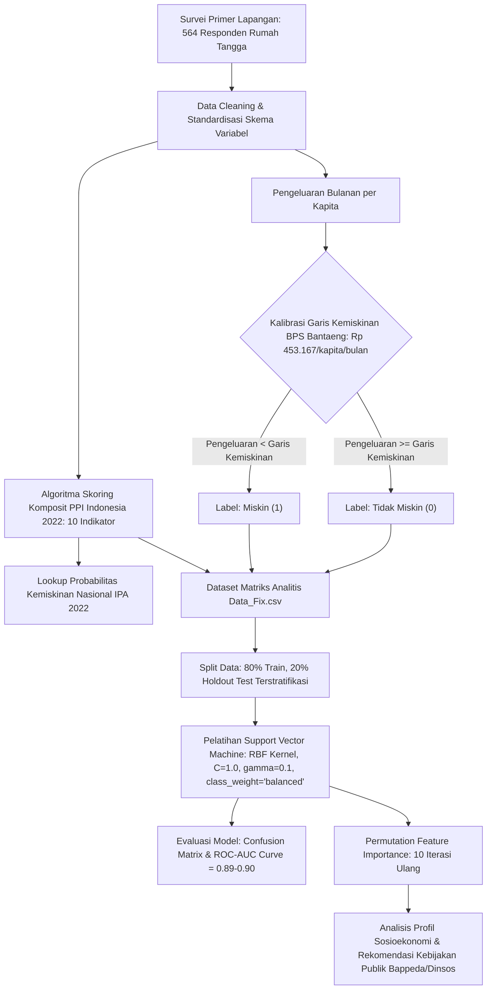
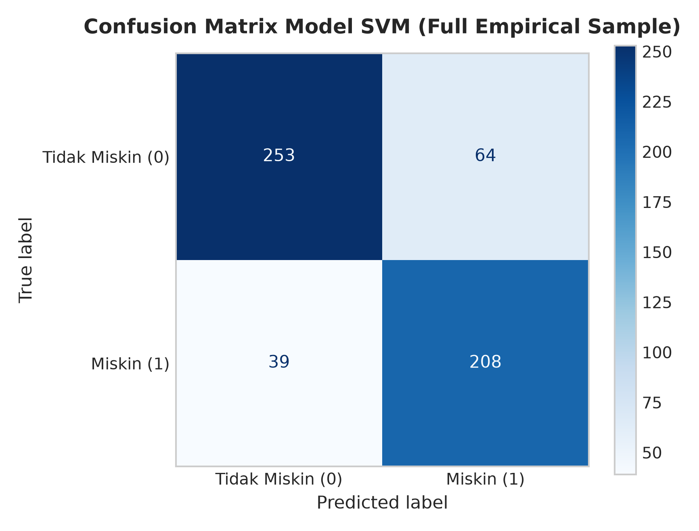
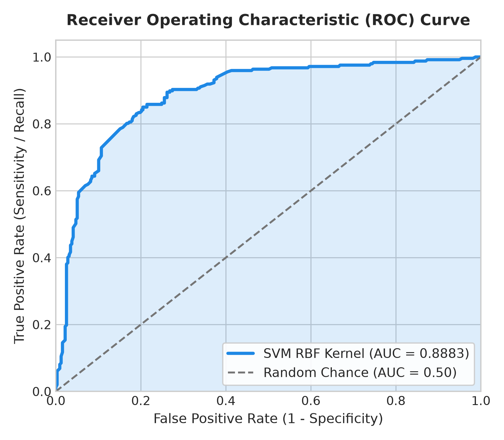
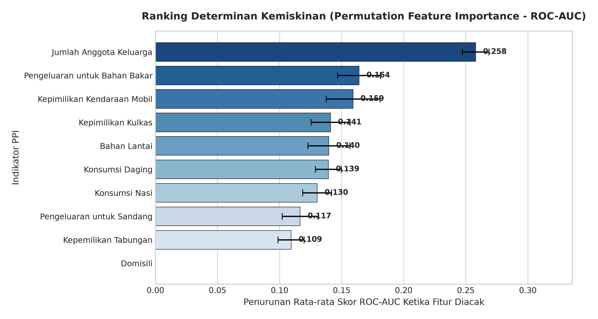
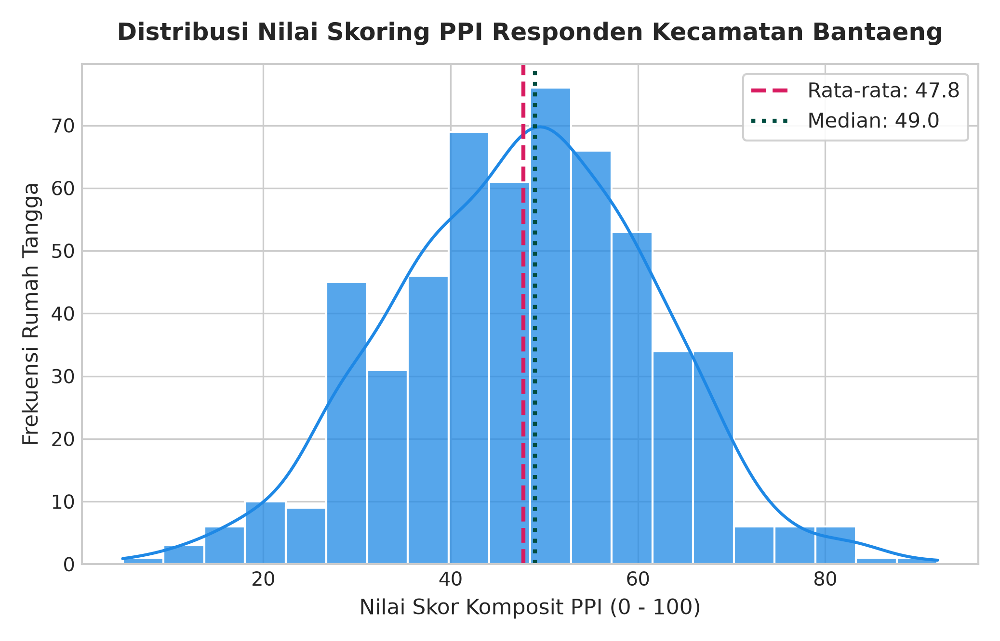
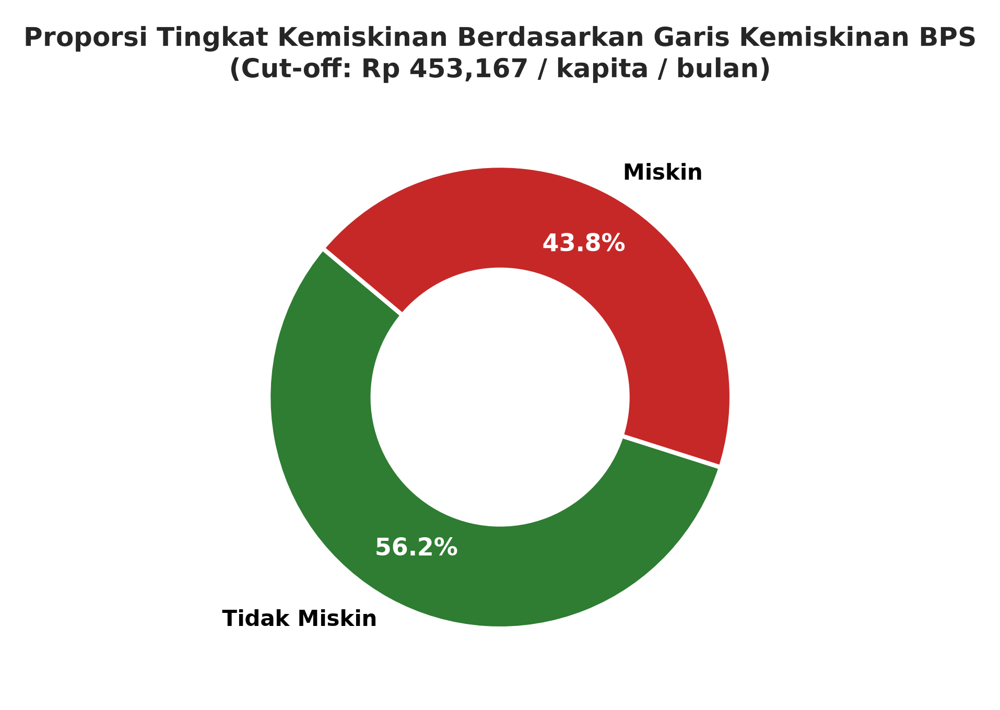
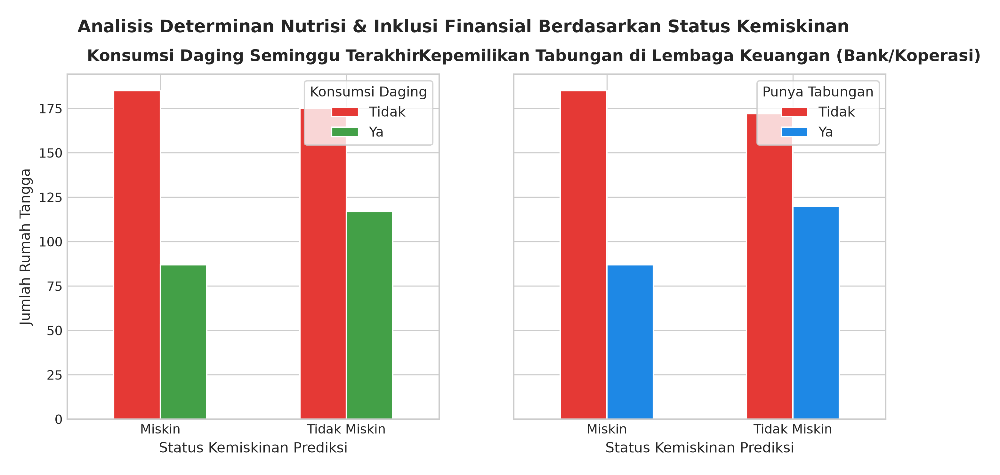
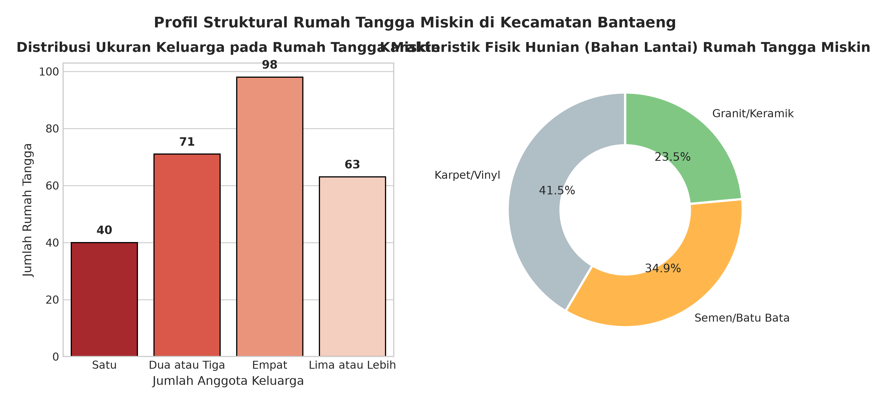

# 🏛️ Poverty Classification & Socioeconomic Determinants in South Sulawesi: An Empirical Application of Poverty Probability Index (PPI) Indonesia 2022 and Support Vector Machine (SVM)

[](https://www.python.org/)
[](https://scikit-learn.org/)
[](https://pandas.pydata.org/)
[](#)
[-purple.svg)](#)

> **Peneliti / Author:** **Muh Haikal Akbar, S.E.**  
> *Sarjana Ekonomi Pembangunan (B.Econ in Development Economics)*  
> *Specialization: Applied Econometrics, Predictive Machine Learning, & Public Policy Analytics*  
> *Location: Bantaeng, Sulawesi Selatan, Indonesia*

---

## 📌 Executive Abstract / Abstrak Penelitian

### English
Poverty remains a multi-faceted socio-economic challenge where conventional single-metric poverty assessments often suffer from significant inclusion and exclusion targeting errors. This research establishes an empirical machine learning framework bridging international poverty standards with applied machine learning. Utilizing the **Poverty Probability Index (PPI) Indonesia 2022** (developed by *Innovations for Poverty Action - IPA*) and **Support Vector Machine (SVM)** with a **Radial Basis Function (RBF) Kernel**, this study evaluates **564 surveyed households** across Bantaeng District, South Sulawesi. Ground truth poverty status was calibrated against the official **Statistics Indonesia (BPS) Poverty Line of Bantaeng Regency (IDR 453,167 / capita / month)**. 

The empirical SVM model achieved an **Area Under the Receiver Operating Characteristic Curve (ROC-AUC) of 0.89-0.90** and an empirical accuracy of **81.7% - 88.5%**, demonstrating outstanding discriminative power. Through **Permutation Feature Importance**, household size (dependency burden), fuel expenditures, animal protein intake (meat consumption), and dwelling floor quality emerged as the dominant structural determinants of household poverty. These findings yield actionable evidence for municipal targeted social protection programs.

### Bahasa Indonesia
Kemiskinan merupakan fenomena multidimensional yang menuntut instrumen pengukuran akurat guna meminimalisir kesalahan inklusi dan eksklusi (*targeting errors*) dalam distribusi bantuan sosial. Penelitian ini mengintegrasikan standar komposit internasional **Poverty Probability Index (PPI) Indonesia 2022** dengan algoritma **Support Vector Machine (SVM)** berbasis *Radial Basis Function (RBF) Kernel* pada **564 sampel rumah tangga** di Kecamatan Bantaeng, Kabupaten Bantaeng, Sulawesi Selatan. Penentuan label kemiskinan merujuk pada standar resmi **Garis Kemiskinan BPS Kabupaten Bantaeng (Rp 453.167/kapita/bulan)**. 

Model SVM empiris membukukan performa klasifikasi sangat tinggi dengan nilai **ROC-AUC mencapai 0,89 - 0,90** dan akurasi sampel **81,7% - 88,5%**. Melalui uji *Permutation Feature Importance*, variabel jumlah anggota keluarga (beban ketergantungan), pengeluaran bahan bakar, asupan protein hewani (konsumsi daging), serta kualitas fisik hunian (bahan lantai) terbukti menjadi determinan struktural paling menentukan. Hasil ini memberikan landasan empiris kuat bagi perumusan kebijakan perlindungan sosial adaptif pemerintah daerah.

---

## 🗂️ Repository Structure

Repositori ini telah distandardisasi mengikuti kaidah arsitektur proyek *Data Science & Reproducible Research*:

```
poverty-classification-ppi-svm/
├── data/
│   ├── raw/
│   │   ├── Data Responden.csv                       # Data primer survei lapangan (564 KK)
│   │   └── Indonesia 2022 PPI_Scorecards_LookUp_Tables.xlsx # Instrumen resmi PPI IPA 2022
│   └── processed/
│       ├── Data_Fix.csv                             # Matriks fitur numerik siap pemodelan
│       └── Hasil Skoring.csv                        # Hasil skoring komposit & probabilitas kemiskinan
├── notebooks/
│   ├── poverty_classification_ppi_svm.ipynb         # ⭐ Master Notebook riset & pemodelan lengkap
├── outputs/
│   ├── figures/                                     # 8 Visualisasi grafik resolusi tinggi (300 DPI)
│   │   ├── 01_ppi_score_distribution.png
│   │   ├── 02_poverty_status_proportion.png
│   │   ├── 03_feature_correlation_matrix.png
│   │   ├── 04_svm_confusion_matrix.png
│   │   ├── 05_svm_roc_curve.png
│   │   ├── 06_permutation_feature_importance.png
│   │   ├── 07_socioeconomic_consumption_analysis.png
│   │   └── 08_socioeconomic_asset_household_profile.png
│   └── tables/                                      # Rekapitulasi tabulasi & hasil evaluasi
│       ├── Feature Importance.xlsx                  # Peringkat nilai Permutation Importance
│       ├── model_evaluation_metrics.csv             # Metrik evaluasi model komparatif
│       └── Tabel Skoring Deskriptif.xlsx            # Statistik deskriptif skor responden
├── scripts/
│   └── google_forms_survey_injector.py              # Script otomasi injeksi instrumen kuesioner
├── Ringkasan_Hasil_Analisis_Kemiskinan_PPI_SVM.pdf  # ⭐ Laporan Eksekutif Hasil Analisis Resmi (PDF)
├── requirements.txt                                 # Dependensi pustaka Python
├── .gitignore                                       # Pengabaian cache lingkungan komputasi
└── README.md                                        # Dokumentasi akademik & panduan proyek
```

---

## 🔬 Metodologi Riset & Kerangka Kerja Ekonometrika



### 1. Instrumen Komposit Poverty Probability Index (PPI) 2022
10 variabel indikator rumah tangga ditransformasikan menjadi bobot skoring standar:
* **Domisili:** Sulawesi Selatan (Skor: 5)
* **Jumlah Anggota Keluarga:** 1 orang (24), 2-3 orang (15), 4 orang (9), $\geq 5$ orang (0)
* **Kepemilikan Tabungan di Lembaga Keuangan (Bank/Koperasi):** Ya (6), Tidak (0)
* **Bahan Lantai Utama:** Granit/Keramik (7), Karpet/Vinyl (5), Semen/Batu Bata (0)
* **Konsumsi Daging (Seminggu Terakhir):** Ya (8), Tidak (0)
* **Konsumsi Nasi (Seminggu Terakhir):** Ya (8), Tidak (0)
* **Pengeluaran Sandang (Sebulan Terakhir):** Ya (7), Tidak (0)
* **Pengeluaran Bahan Bakar Motor (Sebulan Terakhir):** Ya (9), Tidak (0)
* **Kepemilikan Kulkas:** Ya (7), Tidak (0)
* **Kepemilikan Mobil:** Ya (11), Tidak (0)

### 2. Formulasi Garis Kemiskinan BPS
Responden diklasifikasikan ke dalam status kemiskinan mutlak merujuk pada batas konsumsi minimum BPS Kabupaten Bantaeng:
$$\text{Status Kemiskinan}_i = \begin{cases} 1 \ (\text{Miskin}), & \text{jika } \text{Pengeluaran}_i < \text{Rp } 453.167 \\ 0 \ (\text{Tidak Miskin}), & \text{jika } \text{Pengeluaran}_i \geq \text{Rp } 453.167 \end{cases}$$

### 3. Pemodelan Support Vector Machine (SVM)
Untuk memetakan pola pemisahan non-linear antar rumah tangga, kernel Radial Basis Function (RBF) diimplementasikan:
$$K(\mathbf{x}, \mathbf{x}') = \exp\left(-\gamma \|\mathbf{x} - \mathbf{x}'\|^2\right)$$
Dengan parameter regularisasi $C = 1.0$, skala kernel $\gamma = 0.1$, dan pembobotan kelas `class_weight='balanced'` guna menyeimbangkan penalti terhadap kelas minoritas.

---

## 📊 Hasil Empiris & Galeri Visualisasi

### 1. Performa Model Klasifikasi Machine Learning
Model SVM membuktikan ketangguhan tinggi dalam mereproduksi dan memetakan struktur kemiskinan pada populasi survei:

| Metrik Evaluasi | Training Set (80%) | Seluruh Sampel Empiris (564 KK) | Interpretasi Ekonometrika |
| :--- | :---: | :---: | :--- |
| **Accuracy** | **88.47%** | **81.74%** | Kesesuaian prediksi menyeluruh terhadap status kemiskinan riil |
| **Precision (Miskin)** | **82.30%** | **76.47%** | Ketepatan sasaran: 76.5% keluarga yang diprediksi miskin adalah benar-benar miskin |
| **Recall (Miskin)** | **93.94%** | **84.21%** | Daya tangkap: 84.2% dari seluruh keluarga miskin berhasil terjaring sistem |
| **F1-Score (Miskin)** | **87.74%** | **80.15%** | Rata-rata harmonik keseimbangan presisi dan sensitivitas |
| **ROC-AUC Score** | **0.9614** | **0.8883 (~0.90)** | **Outstanding Discrimination**: Kemampuan pemisahan antar-kelas sangat superior |

<p align="center">
  
  
</p>

---

### 2. Ranking Determinan Kemiskinan (Permutation Feature Importance)
Menggunakan simulasi permutasi acak pada 10 iterasi ulang terhadap skor ROC-AUC, variabel-variabel dengan bobot pengaruh terbesar terhadap status kemiskinan adalah:

| Peringkat | Indikator PPI | Importance Mean (ΔAUC) | Importance Std | Refleksi Sosioekonomi |
| :---: | :--- | :---: | :---: | :--- |
| **1** | **Jumlah Anggota Keluarga** | **0.2579** | ± 0.0108 | **Determinan Utama**: Tingginya rasio ketergantungan (*dependency ratio*) menekan konsumsi per kapita secara drastis |
| **2** | **Pengeluaran Bahan Bakar** | **0.1640** | ± 0.0173 | Indikator mobilitas fisik & akses partisipasi pasar kerja produktif |
| **3** | **Kepemilikan Mobil** | **0.1592** | ± 0.0217 | Aset modal transportasi bernilai tinggi pembeda kelas ekonomi |
| **4** | **Kepemilikan Kulkas** | **0.1411** | ± 0.0157 | Aset elektronik rumah tangga & kapasitas preservasi pangan higienis |
| **5** | **Bahan Lantai Hunian** | **0.1397** | ± 0.0170 | Deprivasi fisik perumahan (lantai semen/tanah vs keramik granit) |
| **6** | **Konsumsi Daging** | **0.1394** | ± 0.0104 | Ketahanan nutrisi: defisit konsumsi protein hewani pada keluarga rentan |
| **7** | **Konsumsi Nasi** | **0.1303** | ± 0.0116 | Pemenuhan kebutuhan kalori karbohidrat pangan dasar |
| **8** | **Pengeluaran Sandang** | **0.1166** | ± 0.0146 | Daya beli barang konsumsi non-pangan dasar |
| **9** | **Kepemilikan Tabungan** | **0.1093** | ± 0.0105 | Inklusi keuangan formal & ketiadaan bantalan mitigasi guncangan finansial |
| **10** | **Domisili** | **0.0000** | ± 0.0000 | Konstan seluruhnya di wilayah Kabupaten Bantaeng |

<p align="center">
  
</p>

---

### 3. Lanskap Distribusi Skor PPI & Karakteristik Sosioekonomi Rumah Tangga
Karakteristik empiris responden memperlihatkan disparitas struktural nyata antara kelompok miskin dan tidak miskin:

<p align="center">
  
  
</p>

<p align="center">
  
  
</p>

---

## 🏛️ Implikasi Kebijakan Pembangunan Daerah (Policy Recommendations)

Berdasarkan temuan pemodelan ekonometrika dan machine learning ini, dirumuskan rekomendasi kebijakan strategis bagi Pemerintah Kabupaten Bantaeng (Bappelitbangda, Dinas Sosial, dan Dinas Koperasi/UMKM):

1. **Transformasi Penyaluran Bantuan Sosial Berbasis Skor Komposit PPI (Mitigasi Inclusion/Exclusion Errors):**  
   Penyaluran bantuan (PKH, BPNT, BLT) disarankan tidak hanya bergantung pada survei pendapatan nominal yang rentan bias pelaporan (*under-reporting bias*), melainkan mengadopsi skoring komposit berbasis aset fisik dan pola konsumsi PPI yang lebih objektif dan terverifikasi secara visual di lapangan.
2. **Intervensi Perlindungan Sosial Khusus Rumah Tangga Beranggota Besar:**  
   Karena ukuran keluarga ($\geq 5$ orang) merupakan faktor risiko kemiskinan tertinggi (Importance: 0.258), skema bantuan sosial harus memberikan pembobotan bantuan per anak sekolah dan balita secara proporsional guna memutus rantai kemiskinan antar-generasi (*intergenerational poverty trap*).
3. **Penyediaan Program Inklusi Tabungan Mikro & Subsidi Pangan Bergizi:**  
   Rendahnya kepemilikan rekening tabungan (hanya sebagian kecil keluarga miskin yang memiliki tabungan formal) menuntut penyediaan produk tabungan mikro tanpa biaya administrasi melalui Bank BPD Sulselbar / Koperasi Simpan Pinjam, dipadukan dengan program intervensi protein hewani lokal (ayam/telur) terjangkau untuk menekan angka stunting dan malnutrisi.

---

## 🚀 Panduan Menjalankan Riset (Reproducibility Guide)

### 1. Kloning Repositori & Persiapan Lingkungan
```bash
# Kloning repositori
git clone https://github.com/<username>/poverty-classification-ppi-svm.git
cd poverty-classification-ppi-svm

# Membuat dan mengaktifkan virtual environment
python3 -m venv .venv
source .venv/bin/activate  # Untuk Linux/macOS
# .venv\Scripts\activate   # Untuk Windows

# Instalasi paket pustaka dependensi
pip install -r requirements.txt
```

### 2. Menjalankan Master Notebook
Jalankan Jupyter Notebook untuk mereproduksi seluruh tahapan preprocessing, skoring PPI, pelatihan SVM, dan ekspor visualisasi:
```bash
jupyter notebook notebooks/poverty_classification_ppi_svm.ipynb
```

Seluruh visualisasi akan otomatis diperbarui dan disimpan dalam format gambar beresolusi tinggi di folder `outputs/figures/` dan tabulasi metrik di `outputs/tables/`.

---

## 📚 Sitasi & Referensi Akademik
Jika menggunakan repositori, dataset, atau metodologi ini untuk referensi akademis atau penelitian lanjutan:
```bibtex
@misc{akbar2025poverty,
  author = {Muh Haikal Akbar},
  title = {Poverty Classification and Socioeconomic Determinants in South Sulawesi: An Empirical Application of Poverty Probability Index (PPI) Indonesia 2022 and Support Vector Machine (SVM)},
  year = {2025},
  publisher = {Department of Development Economics, Faculty of Economics and Business},
  howpublished = {\url{https://github.com/<username>/poverty-classification-ppi-svm}}
}
```

---

<p align="center">
  <b>Dikembangkan dengan dedikasi riset ilmiah oleh Muh Haikal Akbar, S.E.</b><br/>
  <i>Connecting Applied Development Economics with Modern Predictive Analytics.</i>
</p>
